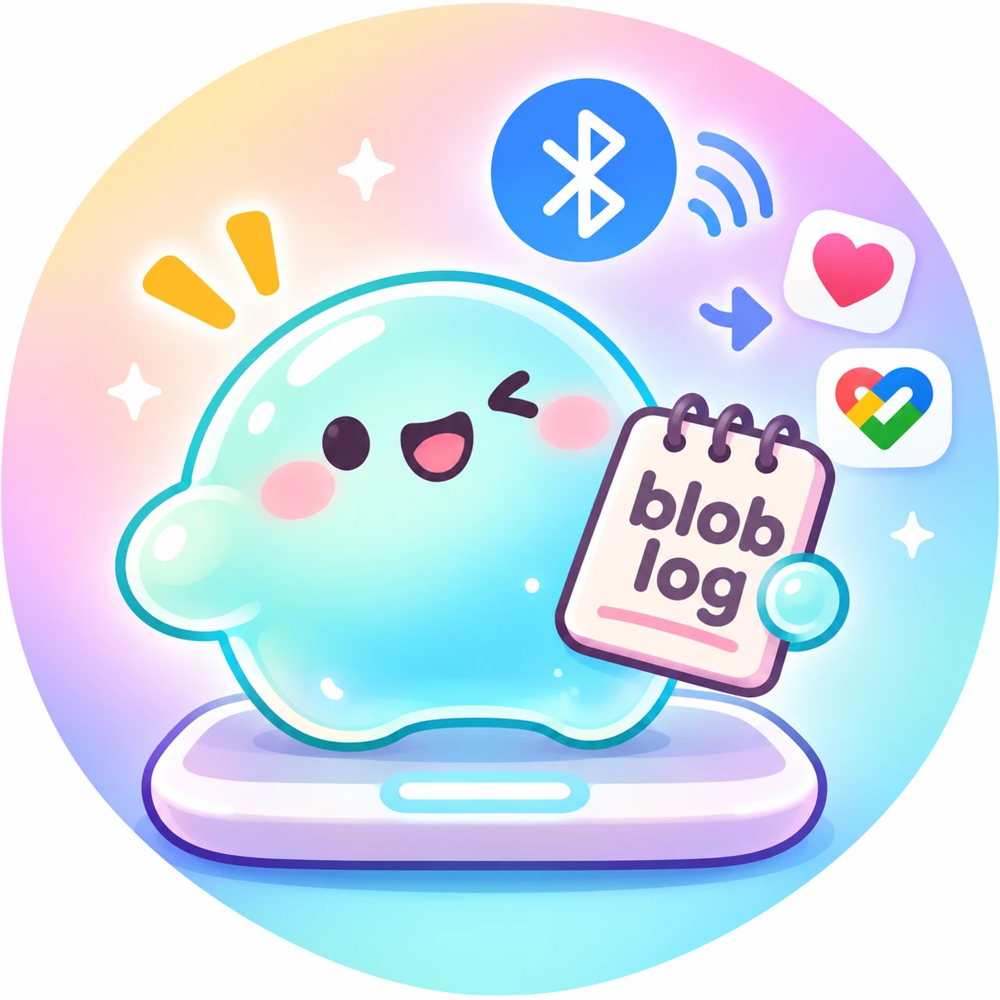
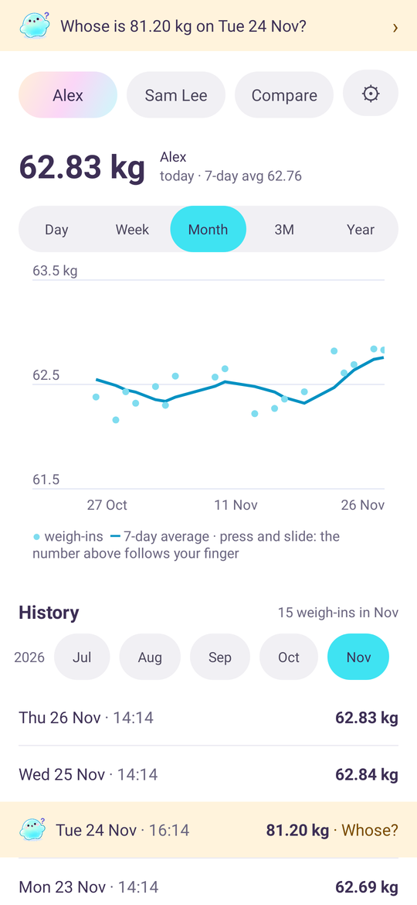
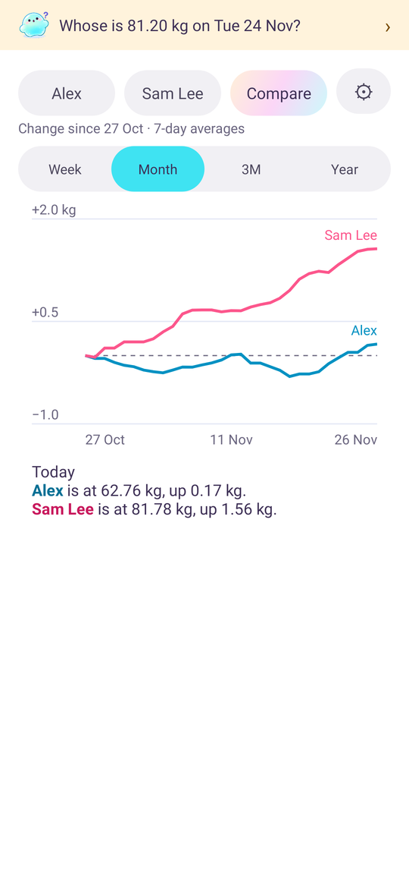
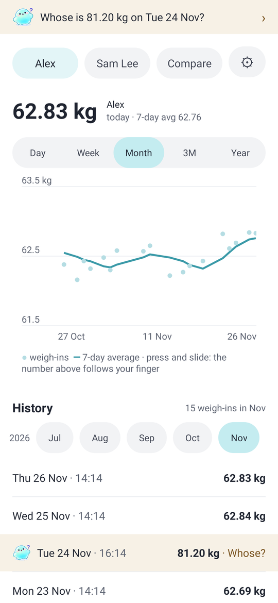
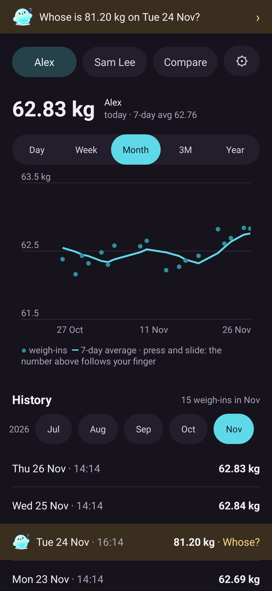
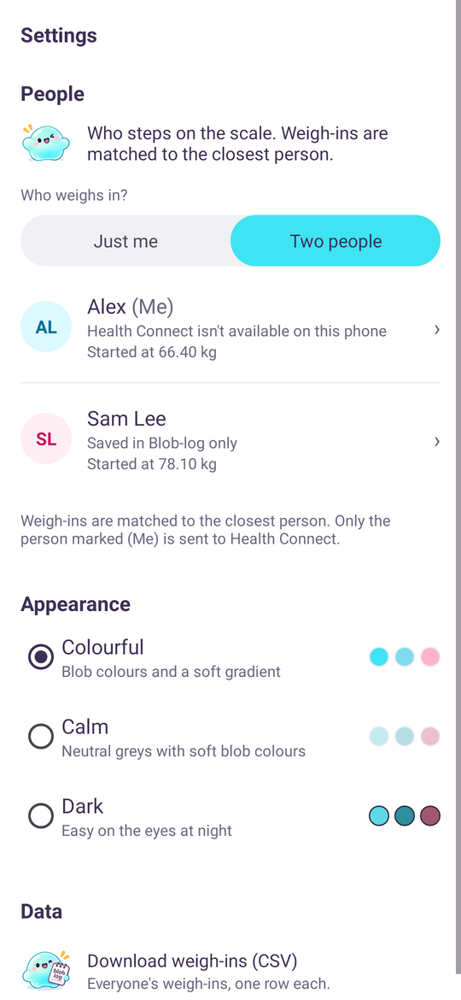

<p align="center"></p>

# Blob-log

A small Android app that catches weigh-ins from a Yolanda / "feelfit" Bluetooth bathroom scale in the background and saves them to **Health Connect**. You don't need the vendor app, and nothing goes to the cloud.

Step on the scale and the weight lands in Health Connect. You don't even have to open the app.

## Status

**v0.3.1. Works on the author's phone.**

- Background capture with the app closed and the screen locked
- Home shows the latest weight, a trend graph (Day to Year) and a History list by month
- Just me (default) or Two people, with a Compare view of both people's change
- Three themes: Colourful, Calm and Dark
- Only the owner's readings are written to Health Connect. Anything that isn't close, such as a guest or a bag, is held back and the app asks "Whose weigh-in?"
- Download all weigh-ins as a CSV file from Settings → Data

Body fat isn't supported: this scale doesn't broadcast impedance (see `SPEC.md`, known gap 1).

## Screenshots

Rendered from the app with sample data.

| Colourful | Compare | Calm | Dark | Settings |
|---|---|---|---|---|
|  |  |  |  |  |

## How it works

The scale only broadcasts and is never connected to. Every reading is in its Bluetooth advertisement: manufacturer ID `0xFFFF` and header `AA BB`, with weight as a little-endian uint16 in 0.01 kg at bytes 17–18 and a "locked" flag (`0x20`) at byte 15. The app registers a system-held BLE scan filtered on that header, so Android wakes it only for scale packets, even after a reboot.

```
scale ──BLE broadcast──▶ ScanReceiver ─▶ SQLite ─▶ assign() ─▶ Health Connect (owner)
                                                          └──▶ "Whose weigh-in?" notification
```

The byte layout, the rules and the exact screen text are in [SPEC.md](SPEC.md). A real capture lives in [docs/scale-capture-2026-11-22.txt](docs/scale-capture-2026-11-22.txt), and the parser tests decode it.

## Get the app: build it yourself

> **There is no download.** Blob-log isn't on Google Play and there's no APK in Releases. To try it, build it from this source and install it on your own Android phone (Android 12 or later). It takes about 15 minutes the first time.

### Option A: Android Studio (easiest)

1. Install [Android Studio](https://developer.android.com/studio) and open it once so it downloads the Android SDK.
2. **File → Open…** and pick this folder (clone it first: `git clone https://github.com/lowjenhui/bloblog.git`).
3. Wait for the Gradle sync to finish, then choose **Build → Build App Bundle(s) / APK(s) → Build APK(s)**.
4. Connect your phone with USB debugging on and press **Run**, or take the APK from `app/build/outputs/apk/debug/`.

### Option B: command line (macOS example)

Needs JDK 17 and the Android SDK (platform 36):

```bash
brew install openjdk@17 && brew install --cask android-commandlinetools android-platform-tools
export JAVA_HOME=/opt/homebrew/opt/openjdk@17/libexec/openjdk.jdk/Contents/Home
sdkmanager "platforms;android-36" "build-tools;36.0.0"
git clone https://github.com/lowjenhui/bloblog.git && cd bloblog
echo "sdk.dir=/opt/homebrew/share/android-commandlinetools" > local.properties
./gradlew :app:testDebugUnitTest :app:assembleRelease
```

This writes a small (~3 MB) shrunk APK to `app/build/outputs/apk/release/app-release.apk`. It's signed with **your own machine's debug key**, so it installs on your phone but isn't meant for publishing.

### Install it on the phone

- **USB or wireless debugging:** `adb install -r app/build/outputs/apk/release/app-release.apk`
- **No cable:** copy the APK to the phone (e.g. via Google Drive), open it, and allow "install unknown apps" when asked.

On first launch the app asks for your name and current weight, then for Bluetooth, notification and Health Connect permissions. Step on the scale and the weigh-in appears.

**Keep your data safe:** updates must be signed with the same key as the installed app. If you rebuild on another computer, Android will refuse the update and you'd have to uninstall, which deletes your weigh-ins. Download a CSV from Settings → Data first.

## Is my scale supported?

Run the scanner on a Mac, from Terminal.app, and step on the scale:

```bash
uv run --with bleak python tools/scan_scale.py 120
```

If it prints `mfr 0xffff: aa bb …` lines with a sensible weight, the app should work with it.

## Docs

- [SPEC.md](SPEC.md): behaviour, protocol, screen text and known gaps (the source of truth)
- [PRD.md](PRD.md): goals, user stories and decisions
- [docs/plans/](docs/plans/): build plans

## Privacy

Readings stay on the phone: in the app's database, and in Health Connect for the owner. The app reads nothing from Health Connect and makes no network calls. It doesn't request internet permission.

## Credits

- The scale's broadcast format follows the QN/Yolanda scale support in [openScale](https://github.com/oliexdev/openScale), an open-source scale app that reverse-engineered these scales. Blob-log's parser was written independently from a capture of a real scale and shares no code with openScale.
- Built with [Claude Code](https://claude.com/claude-code). The plans the code was built from are in [docs/plans/](docs/plans/).

## Disclaimer

Blob-log is a personal hobby project. It isn't affiliated with or endorsed by Yolanda, feelfit, Google, Fitbit or Apple. It isn't a medical device: don't use it for medical decisions. Only tested with one Yolanda scale and one phone.

## License

[MIT](LICENSE)
